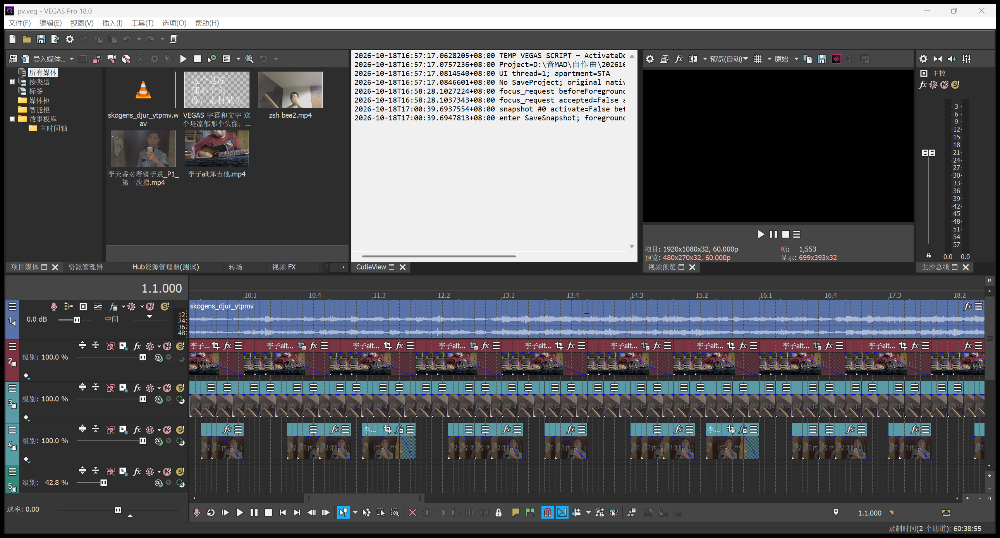
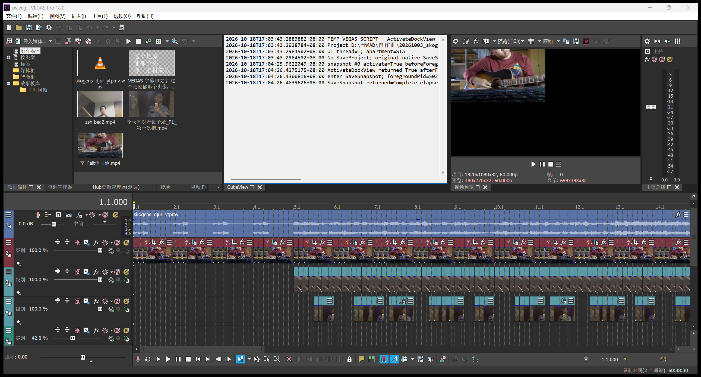
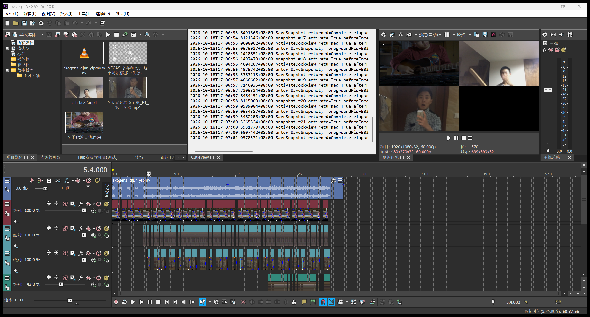
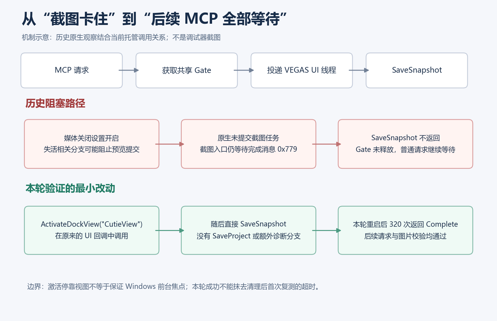
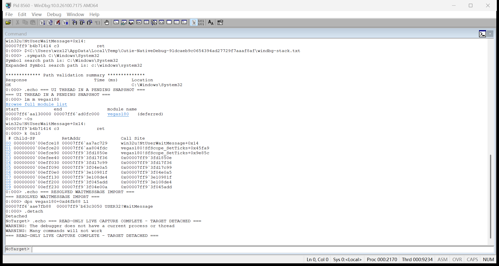
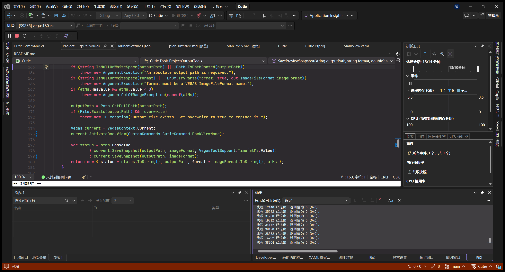
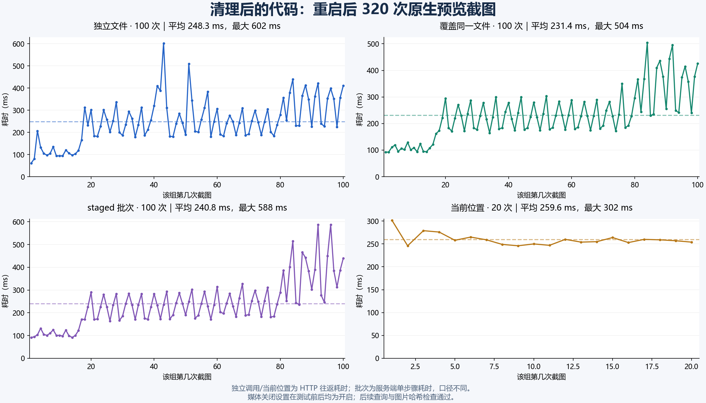
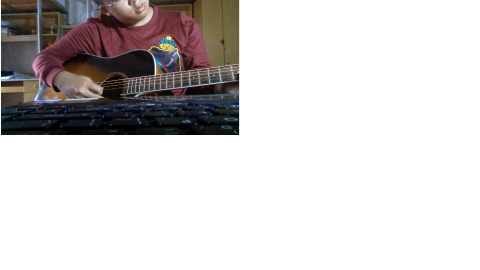
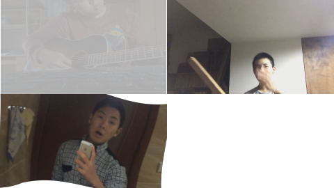
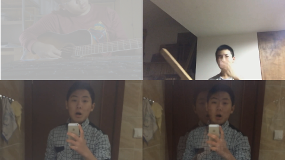

# VEGAS MCP 预览截图阻塞：排查过程与回归记录

> 除了扩展代码排查和WinDbg部分，复现过程、冒烟测试、写文啥的都是AI帮我做的喝喝喝


测试期间“在没有活动应用程序时关闭媒体文件”保持开启，截图前调用 `ActivateDockView("CutieView")`，随后直接调用原生 `SaveSnapshot`。没有恢复保存工程，也没有用项目渲染代替预览截图。

这个结果证明当前工程在本轮条件下可以连续截图，并继续处理 MCP 请求。它不能证明所有场景已彻底修复：清理后、用户重启之前的首次复测仍出现过 20 秒超时，本报告保留这一事实。

## 补充实证：临时 VEGAS 脚本、强制失焦与真实界面截图

用户进一步要求用临时 **VEGAS C# 脚本**启动独立实例，在截图前强制失去焦点，验证是否需要 `ActivateDockView`。这一组于 17:00–17:07 完成，使用同一个 7 轨工程，不修改当前产品代码，不占用用户 MCP 的 57231 端口，也不结束用户的调试实例 PID 39236。

### 如何建立对照

1. PowerShell 在系统临时目录生成 VEGAS 脚本及配套的临时扩展，使用 `-CMDMODULE` 和 `-SCRIPT` 启动独立 VEGAS。普通脚本调用 `vegas.InvokeCommand("Tools", "ActivationTrial")`，由扩展命令回调创建名为 `CutieView` 的停靠视图。
2. 扩展通过临时本机 HTTP 控制入口接收试验指令，再用 `Control.BeginInvoke` 投递到 VEGAS 的 STA/UI 线程。两组使用同一份回调实现，唯一的截图分支差异是是否调用 `ActivateDockView`。
3. 启动另一个进程中的焦点测试窗口，先将前台切到待测 VEGAS，再切到测试窗口。切换使用 `SetForegroundWindow`；必要时短暂使用 `AttachThreadInput`，并在 `finally` 中解除连接。调用后轮询实际前台 PID，确认切换已完成，而不是仅依据 API 返回值。
4. 只读核对该版本原生状态：媒体关闭设置为 1、预览提交阻止字段为 1，且前台 PID 不属于待测 VEGAS。条件未达到时不提交截图。
5. 在 UI 回调里运行以下对照代码，记录进入与返回事件，不保存工程：

```csharp
// 临时扩展里的 UI 回调；activate 是两组之间的对照变量。
if (activate)
{
    bool activated = vegas.ActivateDockView("CutieView");
    // 记录 activated 及实际 Windows 前台 PID。
}

RenderStatus status = vegas.SaveSnapshot(
    outputPath, ImageFileFormat.PNG,
    Timecode.FromMilliseconds(atMs));
```

这组是临时 VEGAS 脚本/扩展试验，**不是产品 MCP 的新增工具，也不计入前述 320 次 MCP 回归**。命令行启动脚本和扩展的方式可参阅 [VEGAS 官方脚本说明](https://help.magix-hub.com/video/vegas/23/en/content/topics/11-autoscript/scripting_vegas.htm?Highlight=scripting)；本机实际验证版本仍为 VEGAS Pro 18 build 527。

最初直接在普通 `FromVegas` 入口创建 `DockableControl`，出现了用户提供的 `ApplicationException`。这是试验入口使用错误；改为由扩展命令创建后正常运行，不把这个错误算作原截图阻塞。

### 两组的实测结果

| 项目                   | 不调用 ActivateDockView                           | 截图前调用 ActivateDockView                |
| ---------------------- | ------------------------------------------------- | ------------------------------------------ |
| 独立 VEGAS PID         | 38424                                             | 39364                                      |
| 焦点测试窗口 PID       | 32728                                             | 5020                                       |
| 已确认的前台切换       | VEGAS → 测试窗口                                  | VEGAS → 测试窗口                           |
| 调用前媒体关闭设置     | 1（开启）                                         | 1（开启）                                  |
| 调用前预览提交阻止字段 | 1                                                 | 1                                          |
| 目标位置               | 0 ms                                              | 0 ms                                       |
| ActivateDockView 返回  | 未调用                                            | `True`                                     |
| 截图结果               | 观察 15181 ms，仍停在 `save_snapshot`，完成数为 0 | `Complete`，返回记录中的截图阶段耗时 61 ms |
| 调用后原生字段         | 阻止提交为 1，文件截图请求为 1                    | 阻止提交为 0，文件截图请求为 0             |

61 ms 是临时脚本返回记录中的计时，包含少量返回后的日志开销；事件日志中原生调用返回时记录为 55 ms，不能把两者当作两次截图。

**本轮最重要的新观察：调用 `ActivateDockView` 后，Windows 前台 PID 仍为 5020，截图依然成功。** 因而该次成功不依赖将 VEGAS 抢回 Windows 前台。可以确认的是：停靠视图激活调用成功、截图返回、调用后的阻止字段已清除；本轮没有在 `ActivateDockView` 与 `SaveSnapshot` 之间再采样，不能把字段清除的具体内部时点写成已经逐指令证明。

### 界面一：失焦后不激活，截图调用没有返回



这是临时实例 PID 38424 的真实窗口截图。中央白色区域是临时扩展在 VEGAS 内显示的实际调用日志，末尾停在 `enter SaveSnapshot`，没有对应的返回记录。后台状态接口在约 15 秒观察后仍报告 `save_snapshot`、完成数为 0。预览黑色本身不是判定阻塞的依据，判定来自请求、事件日志和原生状态共同核对。

原始记录：[`without-activate-result.json`](assets/preview-snapshot-analysis/reproduction-ui/without-activate-result.json)、[`without-activate-events.log`](assets/preview-snapshot-analysis/reproduction-ui/without-activate-events.log)。日志中更早的一次普通前台切换请求曾被 Windows 拒绝；它没有用于正式对照，正式对照的成功切换记录见 JSON 中的 `focusGain` / `focusLoss`。

### 界面二：相同失焦条件，先激活停靠视图后截图返回



这是全新实例 PID 39364 的真实窗口截图，可见 `ActivateDockView returned=True`、`enter SaveSnapshot` 和 `SaveSnapshot returned=Complete`。此前已经确认该进程实际失焦、阻止字段为 1；日志记录激活停靠视图后前台仍属于测试窗口 PID 5020。

原始记录：[`with-activate-result.json`](assets/preview-snapshot-analysis/reproduction-ui/with-activate-result.json)、[`with-activate-events.log`](assets/preview-snapshot-analysis/reproduction-ui/with-activate-events.log)。该次 0 ms PNG 与此前产品 MCP 正常样本的 SHA256 相同。

### 界面三：每次重新强制失焦，重复正向验证



另外正式记录了 **20 次**重复试验，每次都重新执行“VEGAS 获得前台 → 测试窗口获得前台”，确认阻止字段重新变为 1 后，再调用 `ActivateDockView` 和 `SaveSnapshot`。位置为 0–9500 ms，步长 500 ms：

- 20 次均返回 `True` / `Complete`，PNG 均生成。
- 20 次调用前阻止字段均为 1，调用后均为 0，文件截图请求均清零。
- 20 次返回时的 Windows 前台 PID 均为测试窗口 5020。
- 返回记录中的截图阶段平均 143.8 ms，最大 458 ms，包含少量日志开销。

详细数据见 [`with-activate-repeated-results.json`](assets/preview-snapshot-analysis/reproduction-ui/with-activate-repeated-results.json)。临时面板流水号还包含正向单次和预备调用，20 次统计只取该数据文件中的 20 条。曾有一轮在确认焦点切换时停止，未提交下一次截图；之后改为等待并核对实际前台切换完成，才进行正式重复组。

### 这组截图的来源与边界

上述图片均通过临时 PowerShell 调用 `PrintWindow` 采集实际 VEGAS 窗口，没有用预览 PNG、示意图或重绘界面替代。截图方法自身不调用前台激活 API；强制焦点切换是明确记录的试验步骤。采集辅助焦点窗口时得到的无效黑色图片已排除。

这一组把先前“失活状态可能相关”的推断推进到了可重复的现场对照：**实际失焦且阻止提交时，不激活的一次截图未在观察期内返回；相同条件下激活停靠视图，单次及 20 次重复均成功，且不需要恢复 Windows 前台焦点。** 它支持当前改动的有效性，但仍不覆盖所有工程和宿主版本，也不抹去前述重启前超时记录。

## 1. 最初的问题是什么

频繁通过 MCP 保存预览截图后，某一次调用不再返回，随后的普通 MCP 调用也全部等待。用户在 Visual Studio 暂停后提供的调用栈，关键路径是：

```text
ScriptPortal.Vegas.Vegas.SaveSnapshot(...)
Cutie.Tools.ProjectOutputTools.SavePreviewSnapshot(...)
Cutie.ToolRegistration.Invoke(...)
Cutie.ToolExecutor.ExecuteAsync(...)
Cutie.VegasContext.InvokeAsync(...)
Windows Forms 同步上下文回调
```

这把问题定位到了 VEGAS 原生截图调用内，而不是“HTTP 请求没有到达服务端”。用户也确认：注释保存工程代码后仍能复现，移动鼠标不能解除阻塞。

## 2. 为什么一次截图会影响后续 MCP

[`ToolExecutor`](../Cutie/ToolExecutor.cs) 让普通工具与批次共用一个 `SemaphoreSlim`。普通调用获取 Gate 后，经 [`VegasContext`](../Cutie/VegasContext.cs) 投递到 VEGAS 的 UI 同步上下文，工具执行结束才释放 Gate。

因此，`SaveSnapshot` 不返回时，截图请求持有 Gate，后续普通请求自然继续排队。Control/status 工具绕过这条队列，仍可能响应。**后续请求等待是原生截图未完成的连锁结果；直接移除锁或在客户端超时后提前释放锁，不会让原生调用结束。**



图 1：机制示意图，由排查观察和当前代码整理，不是 Visual Studio 或 VEGAS 界面截图。

## 3. 原生排查如何收敛到媒体关闭设置

这条线索不是先猜一个首选项，再试着关闭。追踪顺序是：

```text
SaveSnapshot 内的原生栈
  → 等待指定消息 0x779 的循环
  → 截图入口先调用哪个提交函数
  → 提交函数为什么会提前返回
  → 谁把 +0x32D0 字段置为 1
  → 写入者位于哪个 Windows 消息分支
  → 该分支读取设置编号 0x17
  → 初始化代码把 0x17 与内部名称、界面文字关联
  → 再读取进程实际值并做设置开关对照
```

此前的临时转储已按用户要求清理。为使本节有可查看的原始依据，17:21 起重新用临时脚本启动独立 VEGAS PID **8560**，复现不激活停靠视图的截图等待，再采集 CDB/WinDbg 输出。下列地址、内存值和截图均来自这次补采，不是重新编造的历史现场。

### 3.1 先明确调试对象和地址读法

| 项目       | 本次补采记录                                                                |
| ---------- | --------------------------------------------------------------------------- |
| 目标       | VEGAS Pro 18 build 527，64 位，临时进程 PID 8560（十六进制 `0x2170`）       |
| 调试器     | Windows Debugger / CDB 10.0.26100.7175 AMD64                                |
| 主模块基址 | ``00007ff6`aa130000``（地址中的反引号只是 WinDbg 分隔符）                   |
| EXE SHA256 | `3EDFB8BBD746290DA75CA99B3F4E14C5F6FE005F20C74FBD1577CA3CAAAF6B95`          |
| 目标状态   | 强制失焦，设置实际值为 1；提交阻止字段为 1；截图请求从 0 变为 1，调用未返回 |
| 取证方式   | `-pv -p <PID>` 非侵入采样；读取栈、指令和内存，不设置断点，不执行目标函数   |

完整材料：[`cdb-session.txt`](assets/preview-snapshot-analysis/native-debug/cdb-session.txt)、[`cdb-commands.txt`](assets/preview-snapshot-analysis/native-debug/cdb-commands.txt)、[`reproduction.json`](assets/preview-snapshot-analysis/native-debug/reproduction.json)。命令文件供核查读取过程，不要把历史 PID 8560 当作今后机器上的固定目标。

WinDbg 的 `vegas180+0x67C729` 表示“模块基址加相对虚拟地址 RVA”。本次它等于 ``00007ff6`aa7ac729``；重新启动后绝对基址可能改变，所以分析和复查使用模块加 RVA，不直接复用某个进程的绝对地址。这些 RVA 仅针对上表哈希对应的本机版本。

还需要区分两种符号信息：`USER32!WaitMessage` 可由 Windows 导出信息识别；VEGAS 没有加载私有 PDB，输出中的 `vegas180!SfScope_SetTicks+0x45fa9` 等名称只是附近导出符号加很大偏移，**不能把它当作该私有函数的真实名字**。下文对私有函数按 RVA 和实际指令描述其作用。

### 3.2 Windows 调试栈具体在说什么



这是本次补采的真实 WinDbg 界面。截图在读取后分离时保存，底部 `Detached`、`NoTarget>` 表示调试器已经分离；不是仍处于附加状态的实时窗口。对应原始文本为 [`windbg-stack-session.txt`](assets/preview-snapshot-analysis/native-debug/windbg-stack-session.txt)。

关键输出原文：

```text
0:000> k 0n10
 # Child-SP          RetAddr               Call Site
00 00000000`00efce18 00007ff6`aa7ac729     win32u!NtUserWaitMessage+0x14
01 00000000`00efce20 00007ff6`aa804fdc     vegas180!SfScope_SetTicks+0x45fa9
02 00000000`00efce90 00007ff9`3fd1850e     vegas180!SfScope_SetTicks+0x9e85c

0:000> dps vegas180+0xd4fb88 L1
00007ff6`aae7fb88  00007ff9`b63c3050 USER32!WaitMessage
```

逐项阅读：

- `0:000>` 是调试进程索引 0、线程索引 0；它不是 Windows PID 0。该次进程实际 PID 是 8560，UI 线程的系统 TID 在调试输出中为十六进制 `0x9234`。`~0s` 选择的是本次已经识别出的线程，不能假定所有程序的线程 0 都是 UI 线程。
- `Child-SP` 是该栈帧的栈地址；`RetAddr` 是当前调用返回后继续执行的位置；`Call Site` 是当前帧对应的位置。
- 第 00 帧说明线程处于 `NtUserWaitMessage` 等待位置。它的返回地址减去模块基址是 **`0x67C729`**，因此往回查看该地址之前的调用。
- 第 01 帧的返回地址减去基址是 **`0x6D4FDC`**，把等待循环与截图调用方接上了。
- `dps` 读取并解析导入槽，确认等待循环中的间接调用实际指向 `USER32!WaitMessage`，不是仅凭附近 VEGAS 导出符号猜函数作用。

单独看到 `WaitMessage` 并不能断言死锁，正常空闲 UI 线程也可能在那里等待。这里还需要调用方位于截图路径、截图请求保持置位、请求长期未返回，以及后面的分支证据。栈的列含义与命令规则可参阅 [Microsoft 的栈回溯说明](https://learn.microsoft.com/en-us/windows-hardware/drivers/debuggercmds/k--kb--kc--kd--kp--kp--kv--display-stack-backtrace-)。

原始日志的 `Wake debugger - code 80000007 (first chance)` 是此次调试器唤醒事件，不能作为 VEGAS 崩溃的证据。`(deferred)` 表示符号延迟加载，也不表示模块没有装入。

### 3.3 为什么确认它在等截图完成消息

对截图调用方和等待循环分别使用 `u` 反汇编。本节的指令节选用 RVA 替换绝对地址，并加上人工注释；未经改写的机器码和符号显示都保留在完整 CDB 日志中。

```asm
; 截图调用方
vegas180+0x6D4FBC  call vegas180+0x257540  ; 提交预览/截图依赖的请求
vegas180+0x6D4FC1  xor  r8d,r8d
; ... 准备其他参数，中间没有根据提交返回值决定是否等待
vegas180+0x6D4FD2  mov  ecx,779h
vegas180+0x6D4FD7  call vegas180+0x67C670  ; 进入消息等待循环
vegas180+0x6D4FDC  mov  ecx,eax
vegas180+0x6D4FDE  cmp  eax,779h
```

这里 `ECX=0x779` 是等待函数的第一个整数参数。Windows x64 的前四个整数/指针参数通过 RCX、RDX、R8、R9 传递，见 [Microsoft x64 调用约定](https://learn.microsoft.com/en-us/cpp/build/x64-calling-convention?view=msvc-170)。等待函数入口把该参数保存到 EDI，随后用它与 `MSG.message` 比较：

```asm
vegas180+0x67C692  mov  edi,ecx
; ... PeekMessageW / TranslateMessage / DispatchMessageW
vegas180+0x67C6FE  cmp  dword ptr [rsp+38h],edi
vegas180+0x67C702  je   vegas180+0x67C72E  ; 找到目标消息，走返回路径
; ... 没有消息可处理时
vegas180+0x67C723  call qword ptr [vegas180+0xD4FB88] ; WaitMessage
vegas180+0x67C729  jmp  vegas180+0x67C6A0
```

导入表也做了磁盘复核：`0xD4F620=PeekMessageW`、`0xD4F610=TranslateMessage`、`0xD4F618=DispatchMessageW`、`0xD4FB88=WaitMessage`，见 [`import-slots.json`](assets/preview-snapshot-analysis/native-debug/import-slots.json)。因此它是处理其他窗口消息并等待指定完成消息的循环，不是某个 PNG 文件写入函数阻塞的栈。循环还有退出/取消分支，上述节选没有列全。

`0x779` 是从这个版本的实际调用参数和比较指令识别出的完成标识，不把它当作 Windows 标准消息名或 VEGAS 公共 API 保证。

### 3.4 再追提交函数：什么条件会让它不提交

进入调用方的 `vegas180+0x257540` 后，出现如下分支：

```asm
vegas180+0x257578  mov  r8,qword ptr [r8+0C0h]
; ... 检查对象与视频槽位
vegas180+0x257599  cmp  dword ptr [r8+32D0h],0
vegas180+0x2575A1  jne  vegas180+0x25760E
; ... 真正的提交调用位于后续路径
vegas180+0x25760E  mov  rbp,qword ptr [rsp+38h] ; 返回路径
```

`cmp` 比较该字段是否为零；`jne` 在非零时跳到函数收尾，绕过后面的实际提交。截图调用方却继续进入等待循环，没有先根据提交结果决定是否等待。

所以这里不是泛泛地说“可能有锁”，而是发现了一个具体的不匹配：**提交路径可以被跳过，调用方仍然等待完成消息。** 提交函数的内部返回码含义没有公共定义，本报告不把其返回值擅自命名为某个已知错误码。

本次根据同一对象链读取的现场值为：

```text
root=00000000197c3c60 renderer=0000000071fe4f40
0:000> dd @$t1+0x32d0 L1
00000000`71fe8210  00000001
0:000> dd vegas180+0x117b590 L1
00007ff6`ab2ab590  00000001
```

第一处是提交阻止字段，第二处是文件截图请求标志。它们当时均为 1。读取对象链为 `root = poi(vegas180+0x1172F18)`、`renderer = poi(root+0xC0)`；这是对该版本指令的复现读取，不是 SDK 公开对象布局。

### 3.5 谁会写这个字段：从交叉引用走到应用失活分支

继续找 `+0x32D0` 的写入，得到一对很短的函数：

```asm
; 函数从全局 root 取得同一个 renderer
vegas180+0x2592D8  mov dword ptr [rcx+32D0h],1

; 另一函数清除字段，并经 PostMessageW 发出 0x778
vegas180+0x259308  mov dword ptr [rcx+32D0h],0
vegas180+0x259322  mov edx,778h
```

在磁盘 PE 的可执行节中扫描 `E8/E9` 相对调用候选，再用反汇编复核，找到调用置位函数 `0x2592C0` 的位置包括 **`0x232124`**；清除函数 `0x2592F0` 的调用位置包括 **`0x232D5C`**。完整候选列表为 [`xref-candidates.json`](assets/preview-snapshot-analysis/native-debug/xref-candidates.json)。字节扫描可能把数据误认成指令，所以候选本身不算控制流证明，必须回到指令边界和调用上下文验证。

`0x232124` 位于窗口过程的消息分支中。如何确认它处理的是 `WM_ACTIVATEAPP`，而不是凭函数附近的名字猜测？

1. 窗口过程保存第二个参数 `uMsg` 到 R14D，保存第三个参数 `wParam` 到 RDI。
2. 分派代码先算 `uMsg - 2`，从 RVA `0x2333E4` 的字节表取得压缩索引，再从 RVA `0x233384` 的 DWORD 表取得分支 RVA。
3. 将 Windows 定义的 `WM_ACTIVATEAPP = 0x1C` 代入：`0x1C - 2 = 0x1A`；读取 `0x2333E4 + 0x1A` 得到 **`0x0C`**。
4. 再读 `0x233384 + 0x0C × 4`，得到 **`0x231E7B`**，正是该分支入口。

原始读取结果：

```text
0:000> db vegas180+0x2333fe L1
00007ff6`aa3633fe  0c
0:000> dd vegas180+0x2333b4 L1
00007ff6`aa3633b4  00231e7b
```

在该分支中，保存的 `wParam` 决定激活/失活方向：零值走失活相关路径。Windows 对该消息的定义也明确说明 FALSE 表示当前应用正在失活，见 [WM_ACTIVATEAPP 文档](https://learn.microsoft.com/en-us/windows/win32/winmsg/wm-activateapp)。代码还有宿主自身的条件判断，因此不能说每一次失焦都必然到达下面的置位操作。

在这条失活相关路径末端，发现了真正连接设置编号与阻止字段的指令：

```asm
vegas180+0x232107  mov  rcx,qword ptr [vegas180+0x11734C0] ; 配置对象
vegas180+0x23210E  mov  edx,17h                           ; 设置编号
vegas180+0x232113  call vegas180+0x9B9C20                 ; 查找设置对象
vegas180+0x232118  mov  rcx,rax
vegas180+0x23211B  call vegas180+0x9C43B0                 ; 读取对象的整数值
vegas180+0x232120  test eax,eax
vegas180+0x232122  je   vegas180+0x232146                 ; 零值跳过此处置位
vegas180+0x232124  call vegas180+0x2592C0                 ; 非零时置阻止字段
```

到这里，能说的是“设置 **0x17** 控制了此处是否阻止预览提交”，还不能直接说它是哪一个首选项。

### 3.6 把编号 0x17 连到内部名称，再连到中文界面文字

下一步反向查看设置初始化，而不是靠首选项列表猜名称。初始化片段的关键数据为：

```asm
vegas180+0x3F7144  lea  rdx,[vegas180+0xD6DD38] ; 内部名称字符串
; ... 构造字符串/默认值对象及准备注册参数
vegas180+0x3F7182  mov  dword ptr [rsp+20h],43CEh
vegas180+0x3F7192  mov  r8,qword ptr [rsp+0EC0h]
vegas180+0x3F719A  mov  edx,17h
vegas180+0x3F719F  mov  rcx,qword ptr [vegas180+0x11734C0]
vegas180+0x3F71A6  call vegas180+0x9B89F0
```

同一段初始化将编号 `0x17` 与该内部名称对象一起交给设置注册逻辑。WinDbg 直接读字符串：

```text
0:000> du vegas180+0xd6dd38
00007ff6`aae9dd38  "fCloseMediaOnLossOfFocus"
```

到这里已经有了可读的内部名称，但仍继续核对中文标签。上面的注册参数还包含 `0x43CE`；用 `LoadLibraryEx` 的资源数据加载模式只读打开本机 EXE，再用 `LoadString` 读取该 ID，结果为：

```text
resourceIdHex : 0x43CE
resourceId    : 17358
text          : 在没有活动应用程序时关闭媒体文件
```

读取记录保存在 [`setting-resource-strings.json`](assets/preview-snapshot-analysis/native-debug/setting-resource-strings.json)。资源数据加载不会启动 VEGAS 或执行该 EXE 的入口。这里没有把另一个参数 `0x2891` 猜作某个界面标签，其字符串读取为空，未用它建立结论。

因此完整对应关系是：

| 层次                  | 本次找到的内容                                    | 如何核对                                                                                            |
| --------------------- | ------------------------------------------------- | --------------------------------------------------------------------------------------------------- |
| 失活分支读取的设置 ID | `0x17`，即十进制 23                               | `mov edx,17h` 后调用配置 getter                                                                     |
| 内部属性名            | `fCloseMediaOnLossOfFocus`                        | 初始化代码引用 `0xD6DD38`，`du` 读取字符串                                                          |
| 本机界面文字          | 在没有活动应用程序时关闭媒体文件                  | 同段注册中的资源 ID `0x43CE`，实际 `LoadString` 读取                                                |
| 官方英文选项          | Close media files when not the active application | [VEGAS 常规首选项说明](https://help.magix-hub.com/video/vegas/en/content/topics/prefgeneraltab.htm) |

这一步完成后，才向用户询问具体复选框状态。它不只是内部英文名称与中文文字的语义猜测，而是有注册 ID、字符串引用和本机资源共同对应。

### 3.7 为什么还要读进程实际值，如何读

界面操作意图不等于当前进程已经采用的配置。继续反汇编 getter：`0x9B9C20` 给配置对象指针加 `0x98`，转到 `0x9DC750`；后者按设置编号在有序树中查找，读取节点 `+0x20` 的键，沿左右指针遍历，返回节点 `+0x28` 保存的设置对象。`0x9C43B0` 的主体就是：

```asm
mov eax,dword ptr [rcx+8]
ret
```

按这些读取复现一次查找，得到本次现场：

```text
config=0000000003702750 head=00000000048f60b0
exactCandidate=000000000492bb10 steps=8

0:000> dd @$t3+0x20 L1
00000000`0492bb30  00000017
0:000> dq @$t3+0x28 L1
00000000`0492bb38  00000000`0492a820
0:000> dd poi(@$t3+0x28)+8 L1
00000000`0492a828  00000001
```

先确认节点的键恰好为 `0x17`，再读取其对象 `+8` 的值为 **1**，避免把树的默认/哨兵节点误当目标设置。这也解释了此前“用户以为已取消，但进程中仍读到 1”的对照为何不能算真正关闭设置。

命令的读法：`db` 读字节，`dd` 读 32 位值，`dq` 读 64 位值，`du` 显示 UTF-16 字符串；`poi(...)` 按目标指针宽度解引用。这里 `r @$t0` 等写入的是**调试器伪寄存器**，不是目标 CPU 的 RCX/RAX，也不写目标进程内存。完整带遍历上限的读取过程保留在命令文件中。

### 3.8 哪些是直接观察，哪些仍是解释

直接证据包括：等待栈及返回地址、等待参数 `0x779`、阻止字段非零时的提前返回指令、失活分支读取 `0x17` 后调用置位函数、设置名称/界面资源对应，以及进程实际值为 1。补采现场还观察到：失焦前截图请求为 0，进入截图后为 1，且没有返回。

这些证据与前面的临时脚本正反对照共同支持“媒体关闭相关状态阻止提交，截图入口仍等待完成通知”的解释。它们没有证明所有历史超时都是同一个原因，也没有证明发生了互斥锁循环、完成消息被另一个线程消费，或磁盘写入失败；这些说法不写成已确定结论。

### 3.9 调试器自身暂停目标，也必须记录

`-pv` 非侵入调试仍会在检查期间暂停目标的线程，所谓非侵入不等于完全不影响时序。Microsoft 对此有明确说明，见 [非侵入用户模式调试](https://learn.microsoft.com/en-us/windows-hardware/drivers/debugger/noninvasive-debugging--user-mode-)。读取后用 `qd` 或 `.detach` 分离，不通过执行目标代码来“唤醒”截图。

本次用户反馈整个 VEGAS 窗口卡住时，WinDbg 日志已经显示 `Detached`，而临时进程 PID 8560 仍报告无响应。随即停止后续采集并结束了这个专门创建的临时实例，没有继续启动新实例。自动采集脚本一度误把分离后的 `NoTarget>` 提示当作未完成；这是采集完成标记判断问题，不能据此宣称 WinDbg 仍附加在目标上。

这一观察意味着报告不能保证原生截图阻塞时界面一定还可操作。本次没有继续追查“整体无响应”相较之前状态的具体增量原因，因此也不将其全部归因于调试器暂停或另一个已证实的宿主故障。现存栈和内存记录可以解释已经定位的等待路径，不能代替未做的额外取证。

### 3.10 设置开关的反向对照

静态与现场证据确定对应关系后，再用设置开关检验它是否影响复现，而不是仅以反汇编推断代替实测：

| 对照                                       | 当时的结果                                 | 可以得出的结论                     |
| ------------------------------------------ | ------------------------------------------ | ---------------------------------- |
| 设置开启，原截图路径                       | 能复现阻塞                                 | 原始问题存在                       |
| 用户表示已关闭，但只读核对进程实际值仍为 1 | 仍阻塞                                     | 不能当作有效的关闭设置对照         |
| 确认进程实际值为 0                         | 当前 7 轨工程连续 300 次截图及后续调用通过 | 关闭该选项是本工程的有效对照条件   |
| 恢复开启并核对实际值为 1                   | 再次复现                                   | 加强了媒体关闭状态与问题相关的证据 |

由此形成的解释是：**MCP 从外部触发截图时，VEGAS 的媒体/预览状态可能不满足原生提交条件，而截图入口仍进入完成消息等待。** 它能解释为什么只是给 HTTP 增加超时、改变文件名或者去掉保存工程，都不足以解决问题。

关闭用户常用的首选项不适合作为最终产品方案，所以后续继续在选项开启的条件下寻找处理方式。

## 4. 排除过哪些方向

| 方向                             | 实际观察与处理                                                   |
| -------------------------------- | ---------------------------------------------------------------- |
| 截图前保存工程                   | 禁用后仍复现；最终截图路径不再保存工程                           |
| 鼠标移动唤醒、窗口一直在前台     | 用户重新确认后，不能据此解除或排除阻塞                           |
| 改用 WPF Dispatcher              | 实测仍失败，已撤回                                               |
| 截图前 `UpdateUI()`              | `UpdateUI` 能返回，之后截图仍卡住，已移除                        |
| 经 `RunScriptText` 再进入截图    | 仍能复现，实验类与入口已删除                                     |
| 同一回调先移动光标、再截当前位置 | 仍失败，没有作为修复保留                                         |
| 同一执行锁下拆成两个 UI 阶段     | 仍失败，调度改动已撤回                                           |
| 记录完成消息的 hook              | 有过连续成功，但关闭观察器后复现；不能把受观察的成功等同于修复   |
| 纯透传 hook                      | 仍复现，排除了“只要装 hook 就有效”的判断                         |
| 单帧项目渲染                     | 用户不接受替代方向，已停止并清理                                 |
| 外部 `SetForegroundWindow`       | 当时窗口已经在前台，且激活与调用之间有间隔，没有证明其能修复截图 |

这些实验说明，调度、消息观察和时间间隔都可能影响复现概率。成功次数必须结合调用路径、设置实际值和运行实例一起看，不能只凭一次成功认定根因。

## 5. 最终保留的改动

用户提出并修改的有效候选，是在截图前激活 Cutie 的停靠视图。当前 [`ProjectOutputTools.cs`](../Cutie/Tools/ProjectOutputTools.cs) 的核心路径为：

```csharp
Vegas current = VegasContext.Current;
current.ActivateDockView(CustomCommands.CutieCommand.DockViewName);

var status = atMs.HasValue
    ? current.SaveSnapshot(outputPath, imageFormat,
        VegasToolSupport.Time(atMs.Value))
    : current.SaveSnapshot(outputPath, imageFormat);
```

[`CutieCommand`](../Cutie/CustomCommands/CutieCommand.cs) 中的 `DockViewName` 为 `"CutieView"`，与创建停靠视图使用的名称一致。



这张是用户当前 Visual Studio 的真实编辑器界面，显示保留的 `ActivateDockView` 与紧随其后的 `SaveSnapshot`。调试器当时正在运行，不是原始阻塞现场的调用栈截图。

保留这条路径的理由是：它使用宿主已有的停靠视图 API，改动位置紧邻截图调用，并在原设置开启时通过了连续测试。**它是否通过媒体重开、激活消息或其他宿主内部路径产生效果，目前没有逐次原生追踪证明。** 不能将 `ActivateDockView` 解释为保证取得 Windows 前台焦点的 API。

清理后，截图接口只有原来的四个参数：`outputPath`、`format`、`atMs`、`overwrite`。脚本入口、UpdateUI、消息 hook 等实验参数已移除。两个诊断类源码按用户要求保留，但当前调度器和截图工具没有接入它们，本轮没有启用诊断 hook 或额外日志阶段。

## 6. 清理后如何重新验证

### 运行条件

| 项目         | 本轮记录                                                    |
| ------------ | ----------------------------------------------------------- |
| 最后一轮时间 | 2026-10-18 16:39:36–16:40:57（UTC+8）                       |
| 用户运行实例 | `vegas180.exe`，PID 39236，启动于 16:35:50                  |
| MCP 地址     | `http://127.0.0.1:57231/`                                   |
| 工程         | `20261003_skogens_djur/pv.veg`，7 轨，1920×1080，60 fps     |
| 媒体关闭设置 | 测试前后只读核对均为 1，即开启                              |
| 运行版本核对 | 实际 `tools/list` 返回清理后的四参数 schema，实验参数不存在 |
| 工程状态     | 开始及结束均为未修改；结束恢复原光标位置 30000 ms           |

完整环境、DLL 文件哈希与结果汇总见 [`verification.json`](assets/preview-snapshot-analysis/verification.json)。schema 证明接口已切回清理版；DLL 文件哈希用于记录当时磁盘文件，不等同于直接读取进程内托管程序集的哈希。

### 判定方法

独立调用及覆盖测试均从 0 ms 开始，步长 500 ms，到 49500 ms。每次要求截图返回 `Complete`、PNG 非空，并紧接着执行普通 `get_project_info`，检查队列仍可继续执行及工程状态未改变。

覆盖测试的每一张图、批次测试的每一张图，都与相同时间位置的独立文件样本做 SHA256 比较。当前位置测试先把光标设到 21500 ms，再省略 `atMs` 连续截图，并与该位置的独立样本比较。这里的哈希检查证明各调用方式输出一致，没有另外进行独立参考渲染的像素验证。

### 正式结果

| 场景                          |    次数 | 结果                                       | 平均截图耗时 | 最大截图耗时 |
| ----------------------------- | ------: | ------------------------------------------ | -----------: | -----------: |
| 不同文件名，指定 `atMs`       |     100 | 全通过；每次后续查询通过                   |    248.33 ms |       602 ms |
| 同一文件反复覆盖，指定 `atMs` |     100 | 全通过；每次图片哈希及后续查询通过         |    231.43 ms |       504 ms |
| 一个 staged 批次连续截图      |     100 | 100 张及末尾查询通过；批次后的普通查询通过 |    240.76 ms |       588 ms |
| 省略 `atMs`，截当前位置       |      20 | 全通过；每次图片哈希及后续查询通过         |    259.65 ms |       302 ms |
| 合计                          | **320** | **最后一轮完整回归通过**                   |            — |            — |

批次含末尾查询，共 101 步，轮询观察到完成耗时约 24.58 秒。独立调用和当前位置一栏统计 HTTP 往返时间；批次统计服务端单步时间，两种计时口径不能直接用于比较谁更快。



图 2：依据最后一轮实际 [`timings.json`](assets/preview-snapshot-analysis/timings.json) 绘制，每个点对应一次截图。

### 真实预览截图

以下图片直接复制自本轮 MCP 输出，没有使用 Computer Use 抓取桌面，也没有替换成项目渲染结果。本轮预览截图实际为 **480×270**，工程分辨率为 1920×1080；两者不应混为同一个校验条件，尺寸记录见 [`image-dimensions.json`](assets/preview-snapshot-analysis/image-dimensions.json)。

**0 ms：**



**21500 ms：**



**49500 ms：**



### 必须保留的异常记录

清理后的首次复测在用户重启前的 PID 17604 上，首张 0 ms 截图出现 20 秒客户端超时，未生成目标 PNG，后续测试随即停止。当时没有再取得该次原生线程栈，不能确认它与此前原生等待属于完全相同的现场，也不能把它从结果中删除。

用户重启后，第一轮 320 次截图调用、哈希及后续查询均完成，但测试脚本在最后错误地要求预览 PNG 等于工程分辨率，导致校验报错。这是测试脚本的错误，不是 MCP 调用超时。修正为检查实际预览图片可解码、尺寸有效后，重新执行了上表的 320 次测试，并完整保存数据。上表只统计最后一轮，不混入前一轮或清理前的成功次数。

## 7. 结论与尚未覆盖的范围

这次排查将两个层次分开了：原生 `SaveSnapshot` 等待不结束是截图卡住的位置，共享 Gate 则解释了后续普通 MCP 为什么一起等待。媒体关闭设置的反向对照支持其与触发条件相关；截图前激活 Cutie 停靠视图，是当前保留并通过重启后回归的最小改动。

目前结论限定于这份 7 轨工程和本机版本。补充试验已覆盖临时实例中明确的前台获得/失去循环，但没有重新验证已移动的 64 轨工程、窗口最小化、Cutie 停靠视图不存在、长时间切换前后台等条件。当前产品代码也没有检查 `ActivateDockView` 的返回值。加上清理后首次复测曾超时，现阶段应表述为**“当前重启实例的连续回归通过，失焦对照进一步支持候选改动有效”**，而不是“所有截图阻塞均已永久修复”。

## 8. 单次手动复查命令

在 PowerShell 中执行以下命令，调用的仍是清理后的接口：

```powershell
$body = @{
    jsonrpc = '2.0'
    id = 1
    method = 'tools/call'
    params = @{
        name = 'save_preview_snapshot'
        arguments = @{
            outputPath = Join-Path $PWD.Path 'preview.png'
            format = 'PNG'
            atMs = 21500
            overwrite = $true
        }
    }
} | ConvertTo-Json -Depth 8

Invoke-RestMethod -Uri 'http://127.0.0.1:57231/' `
    -Method Post -ContentType 'application/json; charset=utf-8' `
    -Body ([Text.Encoding]::UTF8.GetBytes($body)) -TimeoutSec 30
```

省略 `atMs` 可截取当前位置。客户端超时只结束等待响应，不会取消已经进入 VEGAS 的原生截图调用；出现超时后，应保留现场检查，不连续重放请求。
